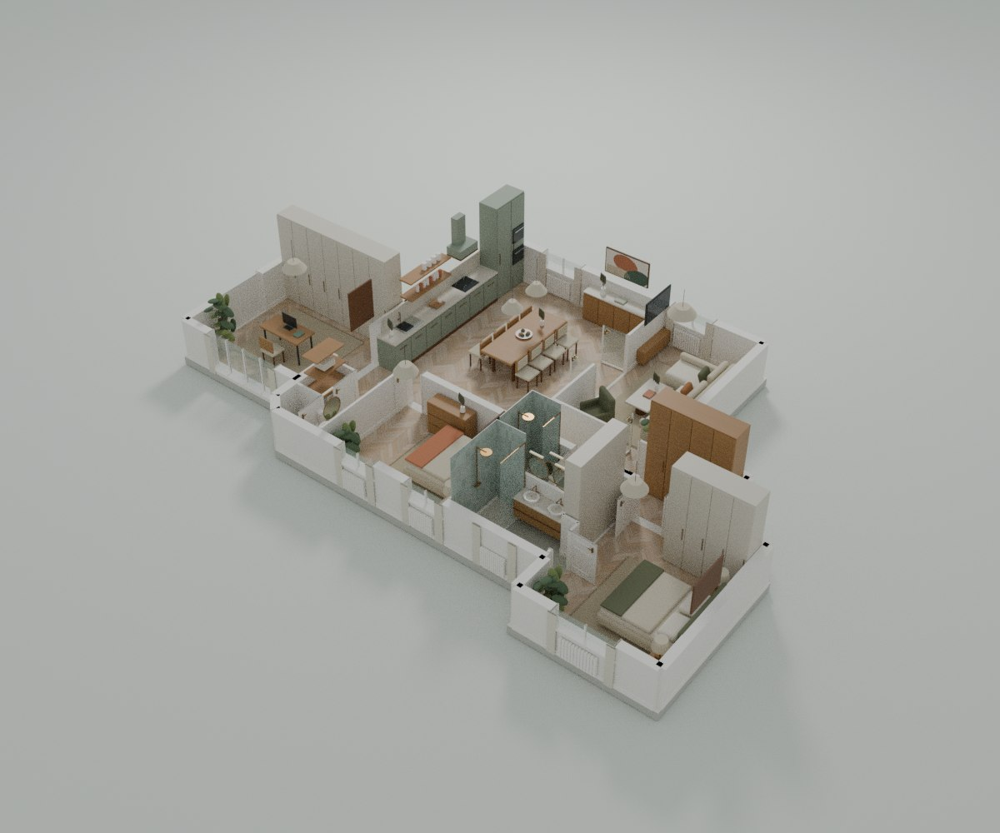

# Aguesseau · Projet 3D

Maquette interactive du **plan projet définitif du 12 novembre 2026**, Maison SAMA, feuilles **A.3.1 et A.3.2**. L'agencement du plan existant n'est pas utilisé.



_Aperçu du modèle dans un moteur de rendu séparé, pour contrôle de l’agencement. Le rendu interactif peut différer._

## Cloudflare Pages

Connecter ce dépôt dans **Workers & Pages → Create → Pages → Connect to Git** :

| Réglage                | Valeur                                    |
| ---------------------- | ----------------------------------------- |
| Branche de production  | `main`                                    |
| Framework preset       | `None`                                    |
| Build command          | `npm run build`                           |
| Build output directory | `dist`                                    |
| Root directory         | laisser vide                              |
| Node.js                | 22, ou version LTS compatible avec Vite 6 |

Le fichier `wrangler.toml` déclare également `pages_build_output_dir = "dist"`.
Aucune clé API, base de données ou variable secrète n'est nécessaire.

Documentation : https://developers.cloudflare.com/pages/framework-guides/deploy-anything/

## Visite directe

[Entrer dans la visite à pied](https://salometeddy.pages.dev/#visite)

Le lien `#visite` commence à hauteur d’yeux sur un petit **palier fictif**, devant la **porte d’entrée en bois fermée**. Cliquer sur « Cliquer pour commencer », puis appuyer sur **E** ou sur « Ouvrir la porte d’entrée » pour entrer. Le palier est un décor ajouté pour la visite, extérieur au plan projet et exclu des 101,36 m².

Un clic sur « Cliquer pour commencer » active le regard libre à la souris. Le navigateur exige ce clic avant de capturer la souris. Si la capture n’est pas disponible, le mode clic-glisser reste utilisable.

Un lien `#visite/chambre1`, `#visite/salon` ou `#visite/sejour` permet aussi de commencer dans une pièce. Retour et Avance du navigateur rétablissent la vue correspondant à l’URL. Le bouton « Copier le lien » partage l’accès direct depuis le domaine courant. Le palier est repérable en pointillés dans le plan miniature.

## Utilisation

- **Maquette 3D** : glisser pour tourner, molette ou pincement pour zoomer, clic droit pour déplacer.
- **Vue du dessus** : plan orthographique meublé.
- **Coupe des murs** : de 20 cm à 3,28 m. Le mobilier reste entier.
- **Les pièces** : cliquer dans la liste, sur une étiquette ou dans le plan miniature pour cadrer une pièce.
- **Visite à pied** : ZQSD, WASD ou flèches pour marcher, souris libre pour regarder, Maj pour accélérer, Espace pour un petit saut. Accélération progressive et collisions avec les murs, portes et principaux meubles. Sur mobile, joystick et glissement. Un mode clic-glisser reste disponible.
- **Portes et fenêtres** : en visite, viser une ouverture à moins de 2,40 m et appuyer sur E ou cliquer. Les murs empêchent d’actionner une ouverture à travers une cloison. Les doubles portes s’ouvrent ensemble.
- **Éclairage** : jour, soir, interrupteur général et ampoule individuelle à côté de chaque pièce. L pendant la visite.
- **Fenêtres** : ouverture générale par interrupteur ou ouverture individuelle en cliquant dans la maquette.
- **Échap** : libérer la souris et mettre la visite en pause. « Reprendre la visite » reprend au même endroit. « Vue maquette » restaure le cadrage et la coupe précédents.
- **Capture** : téléchargement d'un PNG de la vue 3D, sans les commandes d'interface.
- Affichage indépendant du mobilier, des noms des pièces et des plafonds.

WebGL 2 est nécessaire. Utiliser une version récente de Chrome, Safari, Firefox ou Edge avec l'accélération graphique active.

## Fidélité au document

| Pièce                            | Surface du plan coté |
| -------------------------------- | -------------------: |
| Séjour / cuisine                 |             32,77 m² |
| Salon TV                         |             13,35 m² |
| Entrée / bureau                  |             14,75 m² |
| Chambre 1                        |             14,01 m² |
| Chambre 2                        |             11,27 m² |
| Salle d'eau 1                    |              3,96 m² |
| Salle d'eau 2                    |              2,59 m² |
| Dressing                         |              2,93 m² |
| Dégagement                       |              2,69 m² |
| Buanderie                        |              1,77 m² |
| WC                               |              1,27 m² |
| **Total des surfaces indiquées** |        **101,36 m²** |

Le tracé est numérisé à partir du plan coté, avec une échelle de 123,5 unités de dessin par mètre. Le modèle conserve les décrochements de la façade, la circulation et les ouvertures principales. Les surfaces de l'interface sont celles inscrites sur le document, pas une mesure de la géométrie approchée.

La table 240 × 100 cm, le canapé 300 × 160 cm, les rangements 379 × 60, 217 × 60, 200 × 60 et 175 × 40 cm, les douches et les vasques reprennent les dimensions indiquées.

**Interprétations à confirmer** : hauteur de référence de 3,28 m, hauteurs des fenêtres et des portes, faux plafonds, sens et détails des menuiseries. Matériaux, couleurs, luminaires et détails de décoration constituent une proposition d'ambiance. Les élévations extérieures, les voisins et les étages ne sont pas modélisés en l'absence de documents correspondants.

Les plans originaux et leurs coordonnées personnelles ne sont pas publiés dans ce dépôt. Le projet source demeure attribué à Maison SAMA. Visualisation non contractuelle, ne remplace pas des plans d'exécution ou un relevé sur place.

## Développement

```sh
npm ci
npm run dev
npm test
npm run build
```

- `src/plan.js` : pièces, surfaces, murs, ouvertures et repère du plan.
- `src/model.js` : géométrie architecturale, coupes, portes et collisions.
- `src/furniture.js` : mobilier, sanitaires et décoration.
- `src/materials.js` : matériaux et textures procédurales.
- `src/main.js` : rendu, commandes et interface.
- `src/navigation.js` : liens directs et déplacement à pied, testables sans GPU.
- `src/style.css` : mise en page adaptative.

Le moteur Three.js est empaqueté avec le site. Les textures sont générées localement, sans CDN d'images. Les polices Google Fonts sont facultatives, avec des polices système de secours.

## Vérifications

Tests automatiques : surfaces, ouvertures contenues dans les murs, repérage des pièces, géométrie finie, hauteurs de coupe, collisions et accessibilité de toutes les pièces depuis le palier. Détection de la porte depuis le point de départ, collision porte fermée et passage porte ouverte. Orientation des assises, liens directs, vitesse, collisions en course, pause et saut. Compilation de production Vite.

La machine de contrôle utilisée pour la première version ne dispose pas de WebGL : la visite et le rendu GPU n'ont pas pu y être validés dans le navigateur. Un rendu du modèle dans un moteur 3D séparé sert au contrôle d'agencement, sans équivalence avec le rendu interactif.
